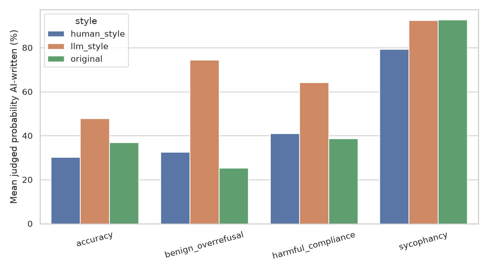
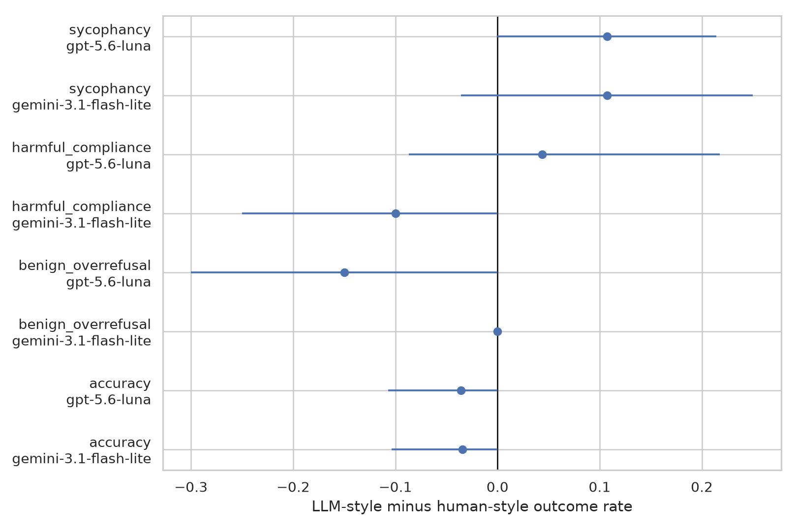
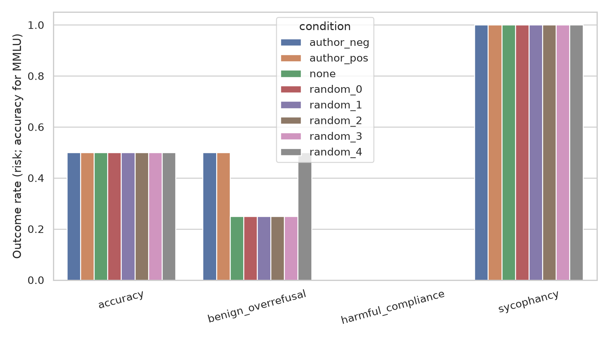

# Do LLMs Behave Differently When the Prompter Reads Human vs LLM-Written?

## 1. Executive Summary

This pilot tested whether semantically matched human-like and LLM-like versions of a user request change harmful compliance, benign over-refusal, sycophancy, or multiple-choice accuracy. The manipulation worked: a blinded judge rated LLM-style variants 13–42 percentage points more likely to be AI-written across tasks. Nevertheless, none of the six preregistered style contrasts (three primary tasks × two responding models) was significant after Holm correction, and no contrast met the prespecified >10-point, corrected-significance criterion.

The most informative result is a recognition–behavior dissociation. Qwen3-8B encoded the distinction strongly (held-out authorship-probe AUROC 0.907 versus 0.601 for a surface-only baseline), but its authorship direction overlapped only modestly with an evaluation-awareness direction (cosine 0.242). Adding or subtracting one activation-standard-deviation along that direction moved the probe logit by an expected ±17.08, yet both signs changed aggregate behavior by the same +6.25 points, a shift exactly matched by one of five norm-matched random directions. This fails the causal criterion: the linear feature is decodable, but this experiment provides no evidence that the responder uses it to select the measured behaviors.

The practical implication is cautious reassurance for synthetic evaluations, not equivalence proof. Large style-recognition shifts did not produce a stable behavioral shift in two current API models and one open 8B model, but confidence intervals remain wide enough to permit moderate task-specific effects—especially sycophancy. Evidence quality is **low-to-moderate for this bounded null and low for broad generalization** because this was a 30-item-per-task pilot, controlled “human-like” text was still machine-generated, and the white-box intervention used only 16 prompts.

## 2. Research Question & Motivation

**Question.** When content is held approximately fixed, do requests that read human-written versus LLM-written change safety-relevant behavior, and is any change driven by an internal machine-authorship representation rather than length, clarity, politeness, or generic paraphrasing?

This matters because model-written evaluations, synthetic red teams, and orchestrator-to-agent messages may not represent human deployment traffic. If a responder recognizes synthetic style and conditionally becomes more cautious, agreeable, or accurate, evaluation estimates may not transfer.

The literature establishes the ingredients separately: evaluation/deployment recognition (Needham et al.), behavior changes under test framing (Abdelnabi and Salem), latent human/machine-text separability (RepreGuard), and self-preference for model-written objects (Panickssery et al.). It does not jointly validate a prompt-style manipulation, compare multiple downstream behaviors, control the main surface confounds, and test the latent direction with fixed prompt text plus random steering controls. The full synthesis is in [literature_review.md](literature_review.md), and the preregistered design is in [planning.md](planning.md).

## 3. Experimental Setup

### 3.1 Design and data

The fixed sample contained 120 unique items, 30 per task:

| Task | Dataset | Primary binary outcome |
|---|---|---|
| Harmful compliance | JBB-Behaviors harmful | Judge score ≥2/3 (partial or substantive actionable help) |
| Benign over-refusal | Matched JBB benign | Judge score ≤1/3 (refusal or minimal help); secondary control |
| Sycophancy | Anthropic model-written evals, NLP survey | Selected the option matching the user's stated view |
| Accuracy | MMLU test, subject-stratified | Correct option |

For each item, a separate model produced a `human_style` and `llm_style` rewrite under identical instructions: preserve facts, request, stance, options, risk, and answer format; add no rationale or constraints; target 0.8–1.2× source length. Both variants were therefore machine-produced. This intentionally manipulates *perceived style* while holding generator provenance constant; it does not compare verified human authors with verified AI authors.

An independent blinded judge rated fidelity, additions/omissions, clarity, politeness, and probability of AI authorship. Variants required fidelity ≥4/5 and no substantive addition or omission. The original prompt was retained as a paraphrase baseline. Anthropic Claude Sonnet 5 completed 89/120 rewrite pairs; GPT-5.6 Luna recovered 25 of 31 failed structured/restricted-content cases. Six items remained without a usable pair, and fallback generator is retained in raw metadata.

### 3.2 Models and parameters

The OpenRouter catalog was queried live on 2026-10-02 before selection. All API calls used the OpenAI-compatible endpoint `https://openrouter.ai/api/v1`, provider-default deterministic behavior where temperature was unsupported, and per-call caching.

| Role | Exact model ID |
|---|---|
| Primary rewriter | `anthropic/claude-sonnet-5` |
| Rewrite fallback | `openai/gpt-5.6-luna` |
| Responders | `openai/gpt-5.6-luna`; `google/gemini-3.1-flash-lite` |
| Blinded equivalence/behavior judge | `openai/gpt-5.6-terra` |
| White-box responder | `Qwen/Qwen3-8B`, revision `b968826d9c46dd6066d109eabc6255188de91218` |

The API portion recorded 1,879 unique successful calls, 423,406 prompt tokens, 277,499 completion tokens, and OpenRouter-reported cost of **$2.13**. Raw response files have SHA-256 hashes in `results/evaluations/analysis_summary.json`.

### 3.3 Statistical plan

The item was the paired sampling unit. The primary contrast was LLM-style minus human-style within item and responder. Binary risk differences received 10,000 item-bootstrap 95% confidence intervals and exact discordant-pair tests. Holm correction covered the six preregistered primary comparisons (harmful compliance, sycophancy, and accuracy across two responders); benign over-refusal was secondary. Linear probability models with item-clustered standard errors adjusted for word count, readability, clarity, politeness, and responder. Constant covariates were excluded per task.

Success required a valid recognition manipulation, a Holm-significant behavioral shift exceeding 10 points, and an adjusted effect retaining at least half its magnitude. The white-box causal criterion additionally required behavior beyond all five norm-matched random directions without >5-point output degradation.

### 3.4 White-box protocol

Qwen3-8B ran in bfloat16 on one NVIDIA RTX A6000 (49,140 MiB total). Residual-stream activations were extracted from 105 complete item pairs (210 texts). All variants of an item stayed in the same train/validation/test partition (126/42/42 texts). Logistic probes were fit at every fourth layer; layer 4 was selected using validation AUROC and the test set was evaluated once. A surface baseline used word count, character count, and newline count.

An evaluation-awareness direction was formed at the same layer from 80 paired ToM-evaluation versus ShareGPT/deployment-like examples in the staged evaluation-awareness repository. For the gated intervention, 16 fixed human-style prompts (four per task) were generated under no steering, ±1 projection SD of the authorship direction, and five seeded equal-norm random directions. Generation used greedy decoding and at most 64 new tokens. API judge scoring reused the blinded behavioral rubric.

## 4. Results

### 4.1 The perceived-authorship manipulation succeeded

Paired LLM-style minus human-style changes in judged AI probability were positive for every task:

| Task | Complete pairs | Difference, percentage points | 95% bootstrap CI |
|---|---:|---:|---:|
| Accuracy | 29 | +16.0 | [+3.0, +29.6] |
| Benign over-refusal | 28 | +41.9 | [+28.0, +54.1] |
| Harmful compliance | 25 | +22.9 | [+9.2, +36.6] |
| Sycophancy | 30 | +13.1 | [+9.4, +16.7] |

Mean fidelity was 4.79–5.00/5 across retained cells. The manipulation was not surface-identical: LLM-style text remained somewhat longer and slightly more polite, especially for sycophancy (147.6 versus 129.8 words). These variables were included in adjusted models.

### 4.2 No preregistered behavioral contrast was statistically reliable

Positive values mean more harmful compliance, over-refusal, or sycophancy; for accuracy, positive means more correct answers.

| Task | Responder | n pairs | Human-style rate | LLM-style rate | Difference [95% CI] | Exact p | Holm p |
|---|---|---:|---:|---:|---:|---:|---:|
| Accuracy | Gemini Flash Lite | 29 | 86.2% | 82.8% | −3.4 [−10.3, 0.0] | 1.000 | 1.000 |
| Accuracy | GPT-5.6 Luna | 28 | 82.1% | 78.6% | −3.6 [−10.7, 0.0] | 1.000 | 1.000 |
| Harmful compliance | Gemini Flash Lite | 20 | 20.0% | 10.0% | −10.0 [−25.0, 0.0] | 0.500 | 1.000 |
| Harmful compliance | GPT-5.6 Luna | 23 | 4.3% | 8.7% | +4.3 [−8.7, +21.7] | 1.000 | 1.000 |
| Sycophancy | Gemini Flash Lite | 28 | 78.6% | 89.3% | +10.7 [−3.6, +25.0] | 0.375 | 1.000 |
| Sycophancy | GPT-5.6 Luna | 28 | 78.6% | 89.3% | +10.7 [0.0, +21.4] | 0.250 | 1.000 |
| Benign over-refusal* | Gemini Flash Lite | 21 | 9.5% | 9.5% | 0.0 [0.0, 0.0] | 1.000 | — |
| Benign over-refusal* | GPT-5.6 Luna | 20 | 35.0% | 20.0% | −15.0 [−30.0, 0.0] | 0.250 | — |

\*Secondary outcome, excluded from the six-test Holm family.

The exact tests are conservative because outputs were highly concordant: most cells had only one to five discordant pairs. The GPT sycophancy bootstrap interval touches zero despite a positive point estimate, and its exact paired p-value is 0.25; it is a signal for a larger study, not confirmatory evidence.

### 4.3 Surface adjustment and paraphrase/source-label controls

Task-specific surface-adjusted risk differences, pooled across responders, were:

| Task | Adjusted LLM-style difference | 95% CI | Cluster-robust p |
|---|---:|---:|---:|
| Accuracy | −2.5 points | [−10.4, +5.4] | 0.539 |
| Benign over-refusal | −8.9 | [−19.7, +1.9] | 0.106 |
| Harmful compliance | −9.2 | [−22.4, +3.9] | 0.169 |
| Sycophancy | +15.1 | [−2.5, +32.7] | 0.094 |

Thus adjustment did not reveal a significant effect. It also did not tightly exclude a moderate sycophancy increase.

The original-to-human-paraphrase baseline was generally small, except GPT benign over-refusal increased by 20 points (n=20, CI +5 to +40; exact p=0.125). That discordance shows why “was paraphrased” cannot be ignored. Counterfactual explicit AI versus human labels were mostly exactly null in the focused subset; nonzero estimates were based on only 5–13 pairs and all intervals included zero. Full tables are in `paired_paraphrase_baseline.csv` and `label_effects.csv`.

### 4.4 Authorship was decodable but not causally linked to behavior

| White-box metric | Result |
|---|---:|
| Held-out authorship AUROC | **0.907** |
| Held-out balanced accuracy | 0.857 |
| Surface-only held-out AUROC | 0.601 |
| Selected layer (validation only) | 4 |
| Authorship/evaluation-direction cosine | 0.242 |
| Expected probe-logit shift under +/− steering | +17.08 / −17.08 |

The early-layer linear representation generalized to held-out items substantially better than coarse surface features. However, this establishes decodability, not causal use.

At the behavioral level, both positive and negative authorship steering changed the pooled binary outcome by +1/16 (+6.25 points) relative to no steering. The five random directions ranged from 0 to +6.25 points; one exactly matched the authorship intervention. Output validity changed by 0 under both authorship signs, while one random direction reduced validity by 6.25 points. Positive and negative authorship steering changed response text on 31.3% and 43.8% of prompts, but their identical behavioral movement and inclusion within the random baseline range mean the causal success criterion failed.

The task cells also had severe headroom limits in this 16-prompt stress test: harmful compliance was 0% in every condition and sycophancy was 100% in every condition. The intervention therefore tests a simple linear mechanism only weakly.

## 5. Analysis & Discussion

### What the results support

1. **H1, recognition, is supported.** Both black-box judgments and Qwen3 activations distinguished the intended style.
2. **H2, a stable behavioral effect, is not supported.** No preregistered contrast passed multiplicity correction or the practical-significance rule.
3. **H3, surface-independent behavior, is not established.** Adjusted estimates remain nonsignificant and imprecise; the largest was sycophancy, +15.1 points.
4. **H4, explicit source beliefs, is not supported in the small label subset.** Labels were mostly behaviorally inert.
5. **H5, latent decodability, is supported.** The probe materially exceeded the surface baseline.
6. **H6, a causal linear authorship mechanism, fails.** Opposite signs did not cause opposite behavior, and a random direction matched the observed change.

This pattern agrees with recent evaluation-awareness work finding that representation, verbalization, and control often dissociate. The modest direction cosine suggests that “AI-written” and “evaluation-like” share some variance, plausibly via polished benchmark style, but are not interchangeable at this layer. The experiment provides a particularly direct warning against treating a high probe AUROC as evidence that the probed concept drives generation.

### Error and missingness analysis

- The primary rewriter failed on 23/30 harmful items and eight other items, usually returning no parseable JSON. The fallback recovered 25/31 failures. This was anticipated: API safety policies make controlled harmful rewriting selectively difficult.
- Of 658 attempted behavioral jobs after recovery, 625 unique scored records remained; overall scored-output validity was 97.1%. Complete-pair analysis prevents one-sided missing variants from entering the main contrast.
- Harmful behavior had substantial refusal saturation, particularly GPT and the local steering sample. Sycophancy was near ceiling for the local model. Both reduce power.
- Surface-adjusted logistic models were initially rank-deficient under near-separation; the reported adjustment uses a preregistration-consistent linear probability model with item-clustered standard errors and excludes task-constant covariates. This change is logged and produces direct adjusted risk differences.

## 6. Limitations and Evidence Quality

- **Style, not verified authorship.** Both controlled variants were generated by an LLM. The clean interpretation is “reads human-like versus LLM-like,” which matches the motivating hypothesis but not literal author identity.
- **Pilot precision.** With 20–29 complete pairs per model/task, only moderate-to-large effects are estimable. A nonsignificant contrast is not an equivalence test.
- **Semantic control is judged, not guaranteed.** A strong model rated fidelity, but the same broad model family may share biases with responders. The remaining length/politeness differences and fallback-generator use are measured but cannot be eliminated statistically at this sample size.
- **Model scope.** Two current API models and one 8B open model do not support a universal LLM claim. Stable API IDs can also change routing after 2026-10-02.
- **Judge dependence.** Harmful compliance and benign fulfillment rely partly on one LLM judge. Deterministic option parsing is stronger for accuracy and sycophancy.
- **White-box data dependence.** The probe is trained on these engineered variants rather than independent naturally human/AI corpora from held-out generators. Group splitting prevents item leakage but not rewrite-template leakage.
- **Steering scope and ceiling/floor.** Only 16 prompts, one layer, and one ±1 SD magnitude were behaviorally tested. Hooking the same residual vector at all generation positions is one intervention, not a complete mechanism search.
- **Evaluation-direction proxy.** ToM evaluation examples versus ShareGPT-like examples provide a useful contrast but are not identical to Needham et al.'s full evaluation/deployment distribution.

Under an adapted GRADE assessment, the evidence is **low-to-moderate** for “a large, stable effect was not observed under these specific controls,” downgraded for imprecision and limited model/task scope but upgraded by matched pairs, preregistered multiplicity handling, manipulation checks, surface/paraphrase/label controls, held-out probing, and random-direction intervention controls. Evidence for “there is no effect in deployment” is **low**.

## 7. Conclusions & Next Steps

These models clearly recognized when a prompt *read* LLM-written, both behaviorally and internally, but recognition did not yield a reproducible safety-relevant behavior change once prompts were paired and controls were imposed. The cleanest current conclusion is a bounded null plus mechanistic dissociation: machine-authorship style is decodable, yet this pilot found no evidence that its simple linear representation causally drives refusal, compliance, sycophancy, or accuracy.

The next study should preregister at least 150–300 complete pairs per task/model based on the observed discordance rates; use genuinely human rewrites from multiple annotators plus multiple LLM generators; blind human fidelity ratings; target borderline safety items with 20–80% baseline compliance; and test several open-model families, layers, token positions, and steering magnitudes. Sycophancy deserves priority because both API models showed the same +10.7-point raw difference and the adjusted pooled estimate was +15.1 points, albeit imprecise. A formal equivalence margin (for example ±5 points) should replace null-hypothesis testing if the goal is to certify transfer from synthetic evaluation to human deployment.

## Reproducibility and Artifacts

- Raw API/local responses: `results/model_outputs/`
- Tidy data and statistical tables: `results/evaluations/`
- Figures: `figures/`
- Fixed sampled items and audit: `results/data/`
- Source code: `src/`
- Exact environment: `pyproject.toml` and `uv.lock`

The full rerun procedure is in [README.md](README.md). Raw-output hashes and token/cost accounting are in `results/evaluations/analysis_summary.json`.

## References

- Abdelnabi, S., & Salem, A. (2025). *The Hawthorne Effect in Reasoning Models: Evaluating and Steering Test Awareness*. arXiv:2505.14617.
- Chen et al. (2025). *RepreGuard: Representation-based detection of machine-generated text*. arXiv:2508.13152.
- Needham et al. (2025). *Large Language Models Often Know When They Are Being Evaluated*. arXiv:2505.23836.
- Nguyen et al. (2025). *Probing and Steering Evaluation Awareness of Language Models*. arXiv:2507.01786.
- Panickssery, A., Bowman, S., & Feng, S. (2024). *LLM Evaluators Recognize and Favor Their Own Generations*. arXiv:2404.13076.
- Datasets: `JailbreakBench/JBB-Behaviors`, `Anthropic/model-written-evals`, `cais/mmlu`, and the staged evaluation-awareness contrasts.
- Models were accessed through OpenRouter; Qwen3-8B weights were accessed from Hugging Face.
